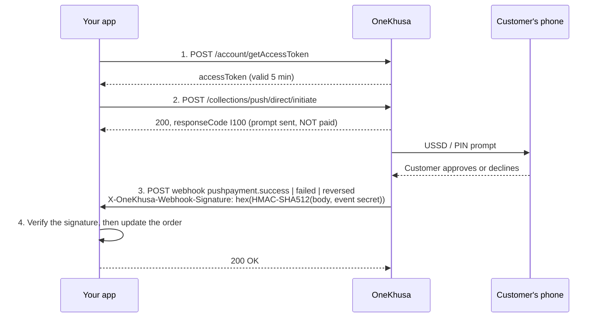

# OneKhusa Push Payments: Blazor / .NET sample

A reference integration for [OneKhusa](https://onekhusa.com) **Direct Push Payments** in a Blazor
Web App (.NET 10). It shows, step by step, how to:

1. Get an access token.
2. Send a payment prompt to a customer's mobile money wallet.
3. Receive the `pushpayment.*` webhooks and **verify their signatures** before trusting them.

The OneKhusa code lives in two small libraries you can copy into your own application. The Blazor
app only shows how to wire them together. The [integration guide](#integration-guide) below walks
through each step with the raw HTTP exchange and the C# code.

> API reference: [Get Access Token](https://docs.onekhusa.com/api-reference/get-started/getaccesstoken) ·
> [Push Payment API](https://docs.onekhusa.com/api-reference/collections/direct-push-payment) ·
> [Push Payment Webhook](https://docs.onekhusa.com/api-reference/webhooks/pushpayment-webhook) ·
> [Verify Webhook](https://docs.onekhusa.com/api-reference/webhooks/verify-webhook) ·
> [Test Accounts](https://docs.onekhusa.com/api-reference/collections/test-accounts)

## Contents

- [How a push payment works](#how-a-push-payment-works)
- [Quick start: run the sample](#quick-start-run-the-sample)
- [Integration guide](#integration-guide)
  - [Step 1. Get your credentials and webhook secrets](#step-1-get-your-credentials-and-webhook-secrets)
  - [Step 2. Configure your app](#step-2-configure-your-app)
  - [Step 3. Get an access token](#step-3-get-an-access-token)
  - [Step 4. Choose a connector](#step-4-choose-a-connector)
  - [Step 5. Initiate the push payment](#step-5-initiate-the-push-payment)
  - [Step 6. Expose a webhook endpoint](#step-6-expose-a-webhook-endpoint)
  - [Step 7. Verify the webhook signature](#step-7-verify-the-webhook-signature)
  - [Step 8. Handle the verified event](#step-8-handle-the-verified-event)
  - [Step 9. Respond to OneKhusa](#step-9-respond-to-onekhusa)
  - [Step 10. Test end to end](#step-10-test-end-to-end)
- [Project layout](#project-layout)
- [Tests](#tests)
- [Notes and limitations](#notes-and-limitations)

## How a push payment works



> **Fulfil an order only after a verified `pushpayment.success` webhook.** The response to the
> initiate call only confirms that the prompt was sent.

## Quick start: run the sample

Prerequisites: the [.NET 10 SDK](https://dotnet.microsoft.com/download), a OneKhusa sandbox
account ([sign up](https://app.onekhusa.com/)), and ngrok or a dev tunnel.

```bash
# 1. Store your credentials (see Step 1 for where to find them)
cd src/OneKhusa.PushPayments.Web
dotnet user-secrets set "OneKhusa:ApiKey" "<api key>"
dotnet user-secrets set "OneKhusa:ApiSecret" "<api secret>"
dotnet user-secrets set "OneKhusa:OrganisationId" "<organisation id>"
dotnet user-secrets set "OneKhusa:MerchantAccountNumber" "<8-digit number>"
dotnet user-secrets set "OneKhusa:Webhooks:Secrets:pushpayment.success" "<secret>"
dotnet user-secrets set "OneKhusa:Webhooks:Secrets:pushpayment.failed" "<secret>"
dotnet user-secrets set "OneKhusa:Webhooks:Secrets:pushpayment.reversed" "<secret>"
dotnet user-secrets set "Demo:CapturedBy" "you@example.com"
cd ../..

# 2. Run the app
dotnet run --project src/OneKhusa.PushPayments.Web --launch-profile http   # http://localhost:5085

# 3. In another terminal, expose it so OneKhusa can deliver webhooks
ngrok http 5085
```

Then:

1. In the portal, register `https://<your-ngrok-host>/webhooks/onekhusa/pushpayment` for the three
   `pushpayment.*` events.
2. Open `http://localhost:5085`. The **Configuration** card should show the credentials and all
   three secrets as configured. Use **Test credentials** to check them.
3. In the **Push Payment** card, send a payment to a [sandbox test wallet](#sandbox-test-wallets).
4. Simulate the customer's response in the portal. Watch it arrive in **Webhook Events** and the
   status change in **Payments**.

## Integration guide

Each step shows the HTTP exchange from the OneKhusa docs, then the C# that does it. The C# comes
from the two libraries in this repo:

- [`OneKhusa.Client`](src/OneKhusa.Client) covers steps 3–5.
- [`OneKhusa.Webhooks`](src/OneKhusa.Webhooks) covers steps 6–9.

You can copy them into your solution as they are, or use the snippets as a blueprint for your own
code.

### Step 1. Get your credentials and webhook secrets

From the [OneKhusa portal](https://app.onekhusa.com/):

| Value | Where to find it | Used for |
|---|---|---|
| API Key | Developers → API Keys | Access token |
| API Secret | Developers → API Keys | Access token. **Server side only.** |
| Organisation ID | Settings → Profile | Access token |
| Merchant Account Number | Merchants (8 digits) | Access token and every payment |
| Webhook secret, **one per event** | Developers → Webhooks → Manage → View | Verifying webhooks |

Register one webhook per event, all pointing at your endpoint:

| Event code | Meaning | Callback URL |
|---|---|---|
| `pushpayment.success` | The customer approved and the funds were collected | `https://<your-host>/webhooks/onekhusa/pushpayment` |
| `pushpayment.failed` | Cancelled, wrong PIN, timed out or insufficient funds | same |
| `pushpayment.reversed` | A successful payment was reversed by the operator | same |

> Each event has a **different** secret. A `pushpayment.failed` delivery must be verified with the
> `pushpayment.failed` secret.

### Step 2. Configure your app

Configuration shape ([appsettings.json](src/OneKhusa.PushPayments.Web/appsettings.json)). Commit
only empty placeholders:

```json
"OneKhusa": {
  "BaseUrl": "https://api.onekhusa.com/sandbox/v1",
  "ApiKey": "",
  "ApiSecret": "",
  "OrganisationId": "",
  "MerchantAccountNumber": 0,
  "Webhooks": {
    "Secrets": {
      "pushpayment.success": "",
      "pushpayment.failed": "",
      "pushpayment.reversed": ""
    }
  }
}
```

Put the real values in user-secrets locally, and in environment variables or a vault such as Azure
Key Vault in production:

```bash
# Local development
dotnet user-secrets set "OneKhusa:ApiSecret" "<api secret>"
dotnet user-secrets set "OneKhusa:Webhooks:Secrets:pushpayment.success" "<secret>"

# Production (environment variables: ':' becomes '__')
OneKhusa__ApiSecret=<api secret>
OneKhusa__Webhooks__Secrets__pushpayment.success=<secret>
```

Register the services in `Program.cs` ([full file](src/OneKhusa.PushPayments.Web/Program.cs)):

```csharp
using OneKhusa.Client.DependencyInjection;
using OneKhusa.Webhooks.DependencyInjection;
using OneKhusa.Webhooks.Endpoints;
using OneKhusa.Webhooks.Handling;

builder.Services.AddOneKhusaClient(builder.Configuration);    // binds "OneKhusa"
builder.Services.AddOneKhusaWebhooks(builder.Configuration);  // binds "OneKhusa:Webhooks"
builder.Services.AddScoped<IPushPaymentWebhookHandler, MyOrderWebhookHandler>(); // Step 8

var app = builder.Build();
app.MapOneKhusaPushPaymentWebhook(); // POST /webhooks/onekhusa/pushpayment (Steps 6-9)
```

### Step 3. Get an access token

**HTTP**

```http
POST https://api.onekhusa.com/sandbox/v1/account/getAccessToken
Content-Type: application/json

{
  "apiKey": "<api key>",
  "apiSecret": "<api secret>",
  "organisationId": "<organisation id>",
  "merchantAccountNumber": 12345678
}
```

```json
{ "accessToken": "eyJhbGciOi...", "expiresOn": "2026-10-26T10:20:12.51Z", "expiryInMinutes": 5 }
```

Each token is **valid for 5 minutes** and tied to one organisation and merchant account. Invalid
credentials return `400` with `{"detail":"Failed to retrieve access token","errorCode":"E900"}`.

**C#** ([AccessTokenProvider.cs](src/OneKhusa.Client/Authentication/AccessTokenProvider.cs)).
Cache the token and refresh it shortly before it expires. Don't request a new one for every call:

```csharp
internal sealed class AccessTokenProvider(IHttpClientFactory httpClientFactory, IOptions<OneKhusaOptions> options,
    TimeProvider timeProvider, ILogger<AccessTokenProvider> logger) : IAccessTokenProvider
{
    private static readonly TimeSpan RefreshMargin = TimeSpan.FromSeconds(60);
    private readonly SemaphoreSlim _refreshLock = new(1, 1);
    private volatile AccessToken? _cachedToken;

    public async Task<OneKhusaResult<AccessToken>> GetAccessTokenAsync(CancellationToken cancellationToken = default)
    {
        if (IsFresh(_cachedToken))
            return OneKhusaResult<AccessToken>.Success(_cachedToken);

        await _refreshLock.WaitAsync(cancellationToken);   // only one caller refreshes
        try
        {
            if (IsFresh(_cachedToken))
                return OneKhusaResult<AccessToken>.Success(_cachedToken);

            var result = await RequestTokenAsync(cancellationToken); // POST account/getAccessToken
            if (result.IsSuccess)
                _cachedToken = result.Value;
            return result;
        }
        finally
        {
            _refreshLock.Release();
        }
    }

    private bool IsFresh(AccessToken? token) =>
        token is not null && timeProvider.GetUtcNow() < token.ExpiresOn - RefreshMargin;
}
```

Every other API call gets the token from a `DelegatingHandler`, so callers never deal with it
([BearerTokenHandler.cs](src/OneKhusa.Client/Authentication/BearerTokenHandler.cs)):

```csharp
internal sealed class BearerTokenHandler(IAccessTokenProvider tokenProvider) : DelegatingHandler
{
    protected override async Task<HttpResponseMessage> SendAsync(HttpRequestMessage request, CancellationToken cancellationToken)
    {
        var token = await tokenProvider.GetAccessTokenAsync(cancellationToken);
        if (!token.IsSuccess)
            throw new OneKhusaAuthenticationException(token.Error);

        request.Headers.Authorization = new AuthenticationHeaderValue("Bearer", token.Value.Value);
        return await base.SendAsync(request, cancellationToken);
    }
}
```

### Step 4. Choose a connector

The push request needs the `connectorId` of the payer's mobile money provider.

**HTTP**

```http
GET https://api.onekhusa.com/sandbox/v1/core/connectors/GetAll
Authorization: Bearer <accessToken>
```

```json
[
  { "connectorId": 769375, "connectorName": "Airtel Money", "channelCode": "M", "isActive": true },
  { "connectorId": 769356, "connectorName": "FDH Bank Limited", "channelCode": "B", "isActive": true }
]
```

**C#** ([IConnectorsClient](src/OneKhusa.Client/Connectors/IConnectorsClient.cs)). Only mobile
network operators (`channelCode` `"M"`) can receive a push prompt:

```csharp
var result = await connectorsClient.GetAllAsync(cancellationToken);
if (result.IsSuccess)
{
    var mobileMoney = result.Value.Where(c => c.IsMobileMoney && c.IsActive).ToList();
}
```

### Step 5. Initiate the push payment

**HTTP**

```http
POST https://api.onekhusa.com/sandbox/v1/collections/push/direct/initiate
Authorization: Bearer <accessToken>
Content-Type: application/json
X-Idempotency-Key: 3f1c9a7e0b8d4e6f9a2b5c7d8e9f0a1b

{
  "merchantAccountNumber": 12345678,
  "connectorId": 769375,
  "payerAccountNumber": "221100000101",
  "sourceReferenceNumber": "PP261026103338NRJ99M",
  "transactionDescription": "Order #1234",
  "transactionAmount": 100,
  "capturedBy": "cashier@example.com"
}
```

```json
{
  "merchantAccountNumber": 12345678,
  "sourceReferenceNumber": "PP261026103338NRJ99M",
  "responseCode": "I100",
  "feeRuleCode": "CC",
  "transactionAmount": 100,
  "totalCharges": 2.5,
  "amountToPay": 102.5
}
```

| Field | Rule |
|---|---|
| `sourceReferenceNumber` | Your own reference, **unique per request**, 5–25 characters. The webhook refers back to it. |
| `X-Idempotency-Key` | A fresh key per new payment. Reuse the same key only to retry a request whose response you never received. |
| `responseCode` | `I100` means the prompt was sent. It does **not** mean the customer paid. |
| `feeRuleCode` | `CC`: fees are added to what the customer pays. `CM`: fees are deducted from what the merchant receives. |

**C#**. This is the pattern [PaymentService.cs](src/OneKhusa.PushPayments.Web/Payments/PaymentService.cs)
follows; `orders.*` stands for your own persistence. Save the payment *before* calling OneKhusa, so
a fast webhook can never arrive for a payment you don't know about:

```csharp
var reference = SourceReference.New(timeProvider);      // e.g. PP261026103338NRJ99M
await orders.SavePendingAsync(reference, amount);        // 1. record it first

var result = await pushPaymentClient.InitiateAsync(new PushPaymentRequest
{
    MerchantAccountNumber = options.Value.MerchantAccountNumber,
    ConnectorId = 769375,                     // from Step 4
    PayerAccountNumber = "221100000101",
    SourceReferenceNumber = reference,
    TransactionDescription = "Order #1234",   // shown to the customer
    TransactionAmount = 100m,
    CapturedBy = currentUser.Email,
}, cancellationToken: cancellationToken);    // a new X-Idempotency-Key is generated

if (!result.IsSuccess)
{
    // API or network error, e.g. "OneKhusa returned HTTP 400: 0999000000 is not a correct test phone number (E900)"
    await orders.MarkNotInitiatedAsync(reference, result.Error.Message);
}
else if (result.Value.IsInitiated)            // responseCode == "I100"
{
    // 2. Prompt sent. Wait for the webhook. Do NOT fulfil yet.
    await orders.MarkAwaitingCustomerAsync(reference, result.Value.AmountToPay);
}
```

### Step 6. Expose a webhook endpoint

OneKhusa delivers each outcome as an HTTP `POST` to your callback URL:

```http
POST /webhooks/onekhusa/pushpayment HTTP/1.1
Content-Type: application/json
X-OneKhusa-Webhook-Event: pushpayment.success
X-OneKhusa-Webhook-Signature: e7b41920d39b821a9b71d2fe4a39281a8b329487c53d10a972c7247853b01938...

{
  "connectorId": 550044,
  "sourceAccountNumber": "265880000000",
  "sourceAccountName": "John Doe",
  "sourceInstitution": "TNM MPAMBA",
  "sourceReferenceNumber": "DII338KORK1",
  "merchantReferenceNumber": "RAE-ABK-44728",
  "beneficiaryAccountNumber": "54833324",
  "transactionReferenceNumber": "260921VK4NEG9V",
  "transactionDescription": "Payment for Order #10234",
  "transactionAmount": 15000,
  "transactionFee": 157.5,
  "transactionDate": "2026-09-21T11:18:42.8474205+02:00",
  "transactionStatusCode": "S",
  "transactionCode": "DMP",
  "responseCode": "S100"
}
```

A `pushpayment.failed` body has `"transactionStatusCode": "F"`, a `responseCode` such as `E307`,
and an `errorMessages` array. It has no `transactionReferenceNumber`.

With the library, mapping the endpoint is a single line:

```csharp
app.MapOneKhusaPushPaymentWebhook(); // POST /webhooks/onekhusa/pushpayment
```

Requirements for the endpoint:

- It must be reachable over **HTTPS from the internet**. Locally, use `ngrok http 5085` or
  `devtunnel host -p 5085 --allow-anonymous`.
- It must **not** require authentication or antiforgery tokens. The signature is the
  authentication.
- It must return the real status code. ASP.NET's `UseStatusCodePagesWithReExecute` (in the Blazor
  template) would turn a `401` into an HTML error page. The library's endpoint switches that off
  for its own responses.

### Step 7. Verify the webhook signature

This is the most important step. Never act on a webhook you haven't verified.

**The algorithm** (from [Verify Webhook](https://docs.onekhusa.com/api-reference/webhooks/verify-webhook)):

```
signature = lowercase_hex( HMAC-SHA512( key = secret for X-OneKhusa-Webhook-Event,
                                        message = raw request body bytes ) )
valid     = constant_time_equals(signature, X-OneKhusa-Webhook-Signature)
```

**The rules**

1. **Use the raw body bytes**, exactly as received, before any JSON parsing. Deserialising and
   re-serialising changes whitespace and number formats, and the signature no longer matches.
2. **Use the secret of the event in the header.** Each event has its own secret.
3. **Compare in constant time** with `CryptographicOperations.FixedTimeEquals`, never with `==`.
4. **Fail closed.** If the signature is missing, the secret is missing or the values don't match,
   reject with `401` and change nothing.

**C# with the library** ([HmacSha512SignatureVerifier.cs](src/OneKhusa.Webhooks/Verification/HmacSha512SignatureVerifier.cs)):

```csharp
public WebhookVerificationResult Verify(string? eventName, string? signature, ReadOnlySpan<byte> rawBody)
{
    if (string.IsNullOrWhiteSpace(eventName))
        return new(WebhookVerificationStatus.MissingEventHeader);
    if (string.IsNullOrWhiteSpace(signature))
        return new(WebhookVerificationStatus.MissingSignatureHeader);

    // Fail closed: without a secret there is no way to tell a genuine delivery from a forged one.
    var secret = secretProvider.GetSecret(eventName.Trim());
    if (string.IsNullOrEmpty(secret))
        return new(WebhookVerificationStatus.NoSecretConfigured);

    byte[] providedSignature;
    try
    {
        providedSignature = Convert.FromHexString(signature.Trim()); // also makes the check case-insensitive
    }
    catch (FormatException)
    {
        return new(WebhookVerificationStatus.InvalidSignatureFormat);
    }

    var expectedSignature = HMACSHA512.HashData(Encoding.UTF8.GetBytes(secret), rawBody);

    return CryptographicOperations.FixedTimeEquals(expectedSignature, providedSignature)
        ? WebhookVerificationResult.Valid
        : new(WebhookVerificationStatus.SignatureMismatch);
}
```

The endpoint ([PushPaymentWebhookEndpoint.cs](src/OneKhusa.Webhooks/Endpoints/PushPaymentWebhookEndpoint.cs))
reads the raw body first, verifies it, and only then parses it:

```csharp
var eventName = ReadHeader(context.Request, WebhookHeaders.Event);         // X-OneKhusa-Webhook-Event
var signature = ReadHeader(context.Request, WebhookHeaders.Signature);     // X-OneKhusa-Webhook-Signature
var rawBody   = await ReadBodyAsync(context.Request, maxBytes, cancellationToken);

var verification = verifier.Verify(eventName, signature, rawBody);
if (!verification.IsValid)
    return Results.StatusCode(StatusCodes.Status401Unauthorized);           // nothing is processed

var payload = JsonSerializer.Deserialize<PushPaymentWebhookPayload>(rawBody); // only now
```

**C# without the library.** This is the whole flow in one minimal API endpoint, to adapt if you'd
rather not take a dependency:

```csharp
using System.Security.Cryptography;
using System.Text;
using System.Text.Json;

app.MapPost("/webhooks/onekhusa/pushpayment", async (HttpRequest request, IConfiguration config) =>
{
    // 1. Read the raw body exactly as received. The signature covers these bytes.
    using var buffer = new MemoryStream();
    await request.Body.CopyToAsync(buffer);
    byte[] rawBody = buffer.ToArray();

    // 2. Read the event and signature headers.
    string eventName = request.Headers["X-OneKhusa-Webhook-Event"].ToString();
    string signature = request.Headers["X-OneKhusa-Webhook-Signature"].ToString();

    // 3. Look up the secret for THIS event (each event has its own). No secret: reject.
    string? secret = config[$"OneKhusa:Webhooks:Secrets:{eventName}"];
    if (string.IsNullOrEmpty(eventName) || string.IsNullOrEmpty(secret) || string.IsNullOrEmpty(signature))
        return Results.Unauthorized();

    // 4. HMAC-SHA512 of the raw body, compared in constant time.
    byte[] expected = HMACSHA512.HashData(Encoding.UTF8.GetBytes(secret), rawBody);
    byte[] provided;
    try { provided = Convert.FromHexString(signature.Trim()); }
    catch (FormatException) { return Results.Unauthorized(); }

    if (!CryptographicOperations.FixedTimeEquals(expected, provided))
        return Results.Unauthorized();

    // 5. Only now parse the body and act on it.
    using var json = JsonDocument.Parse(rawBody);
    string? reference = json.RootElement.TryGetProperty("merchantReferenceNumber", out var r) ? r.GetString() : null;

    switch (eventName)
    {
        case "pushpayment.success":  /* mark order `reference` as paid */  break;
        case "pushpayment.failed":   /* mark order as failed */            break;
        case "pushpayment.reversed": /* reverse the fulfilment */          break;
    }

    return Results.Ok();
});
```

> The snippet above was compiled and tested: a correctly signed request returns `200`, while a
> tampered body, a missing signature or an event without a configured secret each return `401`.

### Step 8. Handle the verified event

With the library, this is the only class you write. It runs only after the signature has been
verified:

```csharp
using OneKhusa.Webhooks;
using OneKhusa.Webhooks.Handling;

public sealed class MyOrderWebhookHandler(OrderService orders) : IPushPaymentWebhookHandler
{
    public async Task HandleAsync(PushPaymentWebhook webhook, CancellationToken cancellationToken)
    {
        var payload = webhook.Payload;
        // Your sourceReferenceNumber from Step 5. See "Notes" for why both fields are checked.
        var reference = payload.MerchantReferenceNumber ?? payload.SourceReferenceNumber;

        switch (webhook.EventName)
        {
            case PushPaymentEvents.Success:   // transactionStatusCode "S": fulfil the order
                await orders.MarkPaidAsync(reference, payload.TransactionReferenceNumber, cancellationToken);
                break;

            case PushPaymentEvents.Failed:    // transactionStatusCode "F": nothing was collected
                await orders.MarkFailedAsync(reference, payload.ErrorMessages, cancellationToken);
                break;

            case PushPaymentEvents.Reversed:  // transactionStatusCode "R": undo the fulfilment
                await orders.MarkReversedAsync(reference, cancellationToken);
                break;
        }
    }
}
```

Guidelines:

- **Be idempotent.** The same event can be delivered more than once. The library acknowledges exact
  redeliveries without calling your handler again, but your state changes should still be safe to
  repeat.
- **Expect events out of order.** For example, don't let a late `failed` undo a `success`. See
  [PaymentWebhookHandler.cs](src/OneKhusa.PushPayments.Web/Payments/PaymentWebhookHandler.cs) for
  one way to guard against this.
- **Stay fast.** Do slow work, such as emails or ERP calls, in the background after recording the
  status.

### Step 9. Respond to OneKhusa

| Situation | Status the library returns | What happens |
|---|---|---|
| Verified and processed | `200` `{"received":true,"outcome":"Processed"}` | Done |
| Verified redelivery of an already processed event | `200` `Duplicate` | Acknowledged; handler not called again |
| Missing or invalid signature, or no secret for the event | `401` | Nothing processed |
| Verified, but the body isn't valid JSON | `400` | Nothing processed |
| Body larger than 64 KB | `413` | Rejected before verification |
| Your handler threw an exception | `500` | Not marked processed, so a retry can succeed |

### Step 10. Test end to end

<a id="sandbox-test-wallets"></a>**Sandbox test wallets** ([docs](https://docs.onekhusa.com/api-reference/collections/test-accounts)).
Any other number is rejected with `E900 … is not a correct test phone number`:

| Provider | Test number | PIN |
|---|---|---|
| Airtel Money | `221100000101` | `1234` |
| TNM Mpamba | `231100000101` | `1234` |

**With OneKhusa:**

1. Initiate a push to a test wallet (Step 5).
2. In the portal, open **Test Your Integration → Simulate Push Payment** and select the pending
   transaction.
3. Choose **Authorize** and enter PIN `1234` to get `pushpayment.success`. Choose timeout, failed
   auth or cancelled to get `pushpayment.failed`.
4. Your endpoint receives the signed webhook. In the sample, it appears in **Webhook Events** with a
   *Webhook Verified* banner.

**Without OneKhusa: sign a test webhook yourself.** These commands produce exactly the signature
OneKhusa would send. Use the secret you configured for the event.

bash (Git Bash, macOS, Linux):

```bash
SECRET='<pushpayment.success secret>'
BODY='{"connectorId":550044,"merchantReferenceNumber":"PP-TEST-001","transactionAmount":100,"transactionStatusCode":"S","responseCode":"S100"}'
SIG=$(printf '%s' "$BODY" | openssl dgst -sha512 -hmac "$SECRET" | sed 's/^.*= //')

curl -i -X POST http://localhost:5085/webhooks/onekhusa/pushpayment \
  -H "Content-Type: application/json" \
  -H "X-OneKhusa-Webhook-Event: pushpayment.success" \
  -H "X-OneKhusa-Webhook-Signature: $SIG" \
  --data-binary "$BODY"
```

PowerShell:

```powershell
$secret = "<pushpayment.success secret>"
$body   = '{"connectorId":550044,"merchantReferenceNumber":"PP-TEST-001","transactionAmount":100,"transactionStatusCode":"S","responseCode":"S100"}'

$hmac = [System.Security.Cryptography.HMACSHA512]::new([System.Text.Encoding]::UTF8.GetBytes($secret))
$signature = -join ($hmac.ComputeHash([System.Text.Encoding]::UTF8.GetBytes($body)) | ForEach-Object { $_.ToString("x2") })

Invoke-WebRequest -UseBasicParsing -Method Post -Uri "http://localhost:5085/webhooks/onekhusa/pushpayment" `
  -ContentType "application/json" `
  -Headers @{ "X-OneKhusa-Webhook-Event" = "pushpayment.success"; "X-OneKhusa-Webhook-Signature" = $signature } `
  -Body $body
```

Expect `200`. Change one character of the body and send the same signature again, and you should
get `401`. In the sample app, **Send Test Webhook** in the Webhook Events card does the same thing
from the UI (Development only).

**Troubleshooting**

| Symptom | Likely cause |
|---|---|
| `E900 Failed to retrieve access token` | API key, secret, organisation or merchant number don't belong together |
| `E900 … is not a correct test phone number` | Sandbox only accepts the test wallets above |
| ngrok shows `404 Not Found` for the webhook | The tunnel forwards to a different app or port than this one |
| Every real delivery returns `401` | The secret for that event is missing, or it's another event's secret |
| Signature matches with your own test but not with OneKhusa | The body is being parsed or re-encoded before verification. Hash the raw bytes |

## Project layout

| Project | What it is | Copy it? |
|---|---|---|
| [src/OneKhusa.Client](src/OneKhusa.Client) | API client: token caching, connectors, push initiation. No ASP.NET dependency. | Yes |
| [src/OneKhusa.Webhooks](src/OneKhusa.Webhooks) | Webhook receiver: HMAC-SHA512 verification, per-event secrets, deduplication, minimal API endpoint. | Yes |
| [src/OneKhusa.PushPayments.Web](src/OneKhusa.PushPayments.Web) | Blazor demo (Interactive Server): one dashboard with Push Payment, Webhook Events, Payments and Configuration cards, one component each in `Components/Dashboard`. | Use as a reference |
| [tests/](tests) | xUnit tests for the libraries and end-to-end tests of the webhook endpoint. | |
| [samples/http/onekhusa.http](samples/http/onekhusa.http) | Raw requests for the VS Code REST Client or the Visual Studio `.http` editor. | |

## Tests

```bash
dotnet test
```

- Signature verification is tested against a vector computed independently with `openssl`. Other
  cases: a tampered body, re-formatted JSON, another event's secret, missing headers, a missing
  secret and a non-hex signature.
- Token caching is tested for expiry refresh and for concurrent callers sharing one token request.
- The push request is checked against the documented field names and headers. API errors are
  checked to show `detail` and `errorCode`.
- End-to-end webhook tests run through the real ASP.NET pipeline: signed, unsigned, wrong-secret,
  duplicate, malformed and oversized deliveries.

## Notes and limitations

- Payments, deduplication records and the webhook log are kept **in memory** and lost on restart.
  Replace `IPaymentStore` and `IWebhookDeduplicator` with database-backed versions in production,
  especially if you run more than one instance.
- The docs' webhook examples don't say clearly which field echoes your `sourceReferenceNumber`. The
  `failed` example has only `merchantReferenceNumber`, which suggests that one, while
  `sourceReferenceNumber` looks like the operator's own reference. The sample checks both. Confirm
  against a real sandbox delivery in the Webhook Events card.
- The docs spell the event header both `X-OneKhusa-Webhook-Event` and `OneKhusa-Webhook-Event`.
  The library accepts both.
- Request to Pay is out of scope for this sample.
